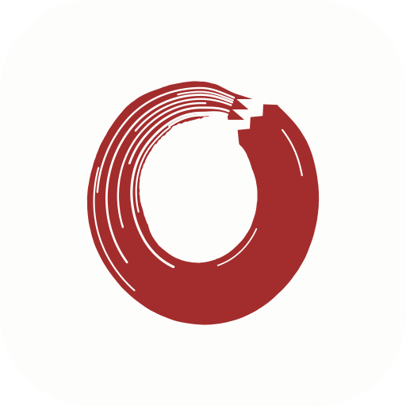
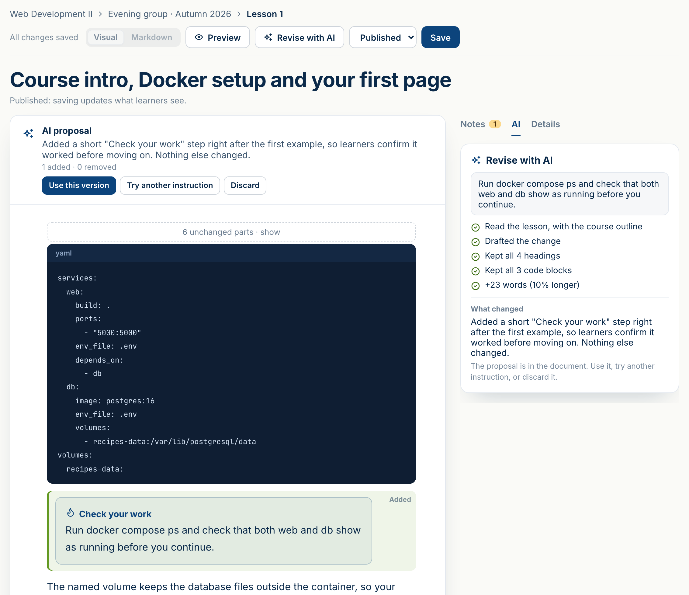
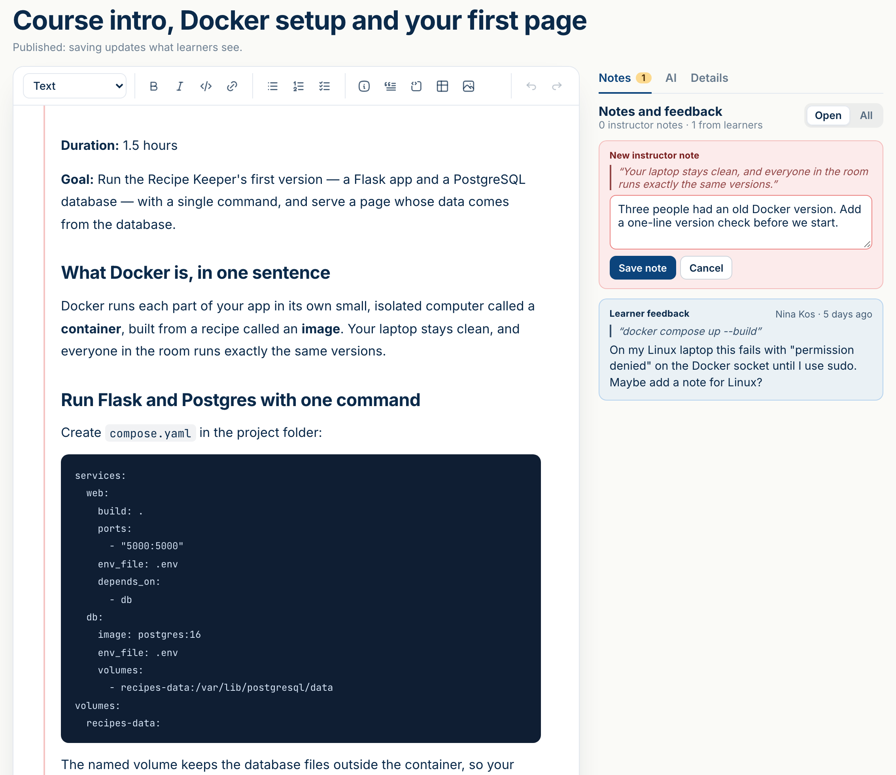
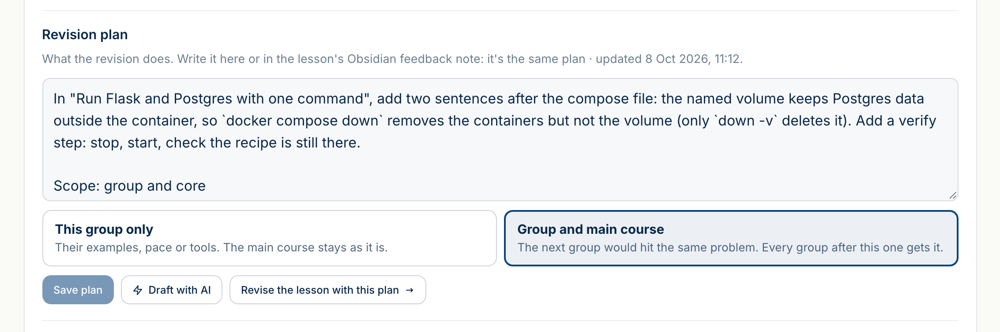
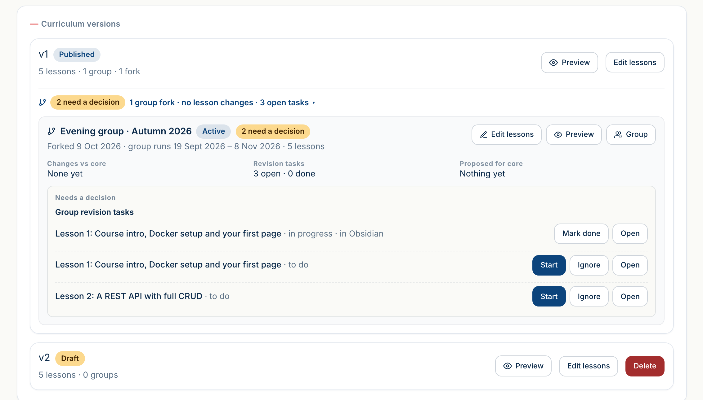

<p align="center">
  
</p>

<h1 align="center">Chalkenso</h1>

<p align="center">
  <strong>AI-assisted curriculum design: courses that get better every time they're taught.</strong>
</p>

<p align="center">
  Self-hosted &nbsp;·&nbsp; one organisation &nbsp;·&nbsp; Docker &nbsp;·&nbsp; Obsidian &amp; Claude Code &nbsp;·&nbsp; free for personal use
</p>

<p align="center">
  Built by <a href="https://bostjan-cigan.com">Boštjan Cigan</a>
</p>

<p align="center">
  <a href="https://chalkenso.com"><strong>Chalkenso cloud</strong></a> &nbsp;·&nbsp;
  <a href="#installation"><strong>Install it yourself</strong></a> &nbsp;·&nbsp;
  <a href="https://github.com/bostjan-cigan/chalkenso-obsidian"><strong>Chalkenso for Obsidian</strong></a>
</p>

<p align="center">
  
</p>

Chalkenso is for people who write courses and teach them. Plan a course that holds together, teach it to
groups through private links, and collect what happens in class: learners leave feedback on the exact sentence,
instructors leave notes in the margin. AI turns that into a plan and a revised lesson, and shows every change
before you use it. People approve every change.

This is the **local edition**: the same web app as the hosted Chalkenso, for one organisation on your own server.
Write lessons in the browser or as notes in your Obsidian vault, and let Claude Code plan and apply the fixes
from class feedback. It's free for personal use; schools and companies need a license or the cloud
([License](#license)).

Rather not run a server? **[Chalkenso cloud](https://chalkenso.com)** is the same app, hosted, with learner
surveys, Insights, the curriculum map and your own website on top. Your first group is free.

**Contents:** [What Chalkenso can do](#what-chalkenso-can-do) · [Local edition or cloud](#local-edition-or-cloud) · [Installation](#installation) · [Development](#development) · [License](#license)

---

## What Chalkenso can do

- **Courses that hold together.** Courses, versions, parts (arcs) and lessons, edited in the browser (visual or
  Markdown) or synced from Obsidian. Publish a new version when it's ready.
- **Revise with AI.** Say what to change in a lesson. AI rewrites it and shows every changed paragraph before
  you use it.
- **Groups and private links.** Each group gets its own copy of the course, a roster and private, expiring links
  for its learners.
- **Feedback on the exact sentence.** Learners mark a passage and say what's unclear, keep private notes, and ask
  an AI assistant about a paragraph.
- **Instructor notes.** The team preview shows the course the way learners see it. Mark any passage and leave a
  note for the team, or a private one.
- **One inbox, one plan per lesson.** Feedback and notes land in one place. Tick what to fix and **Plan the
  changes** writes the revision plan from the lesson, its feedback and the course outline. Edit it yourself, or
  **Ask for changes**.
- **You decide where a change goes.** This group only (their examples, pace or tools), or the group and the main
  course, so every group after this one gets it.
- **A team.** One manager and the instructors they invite with a link, each with every course or only the courses
  and groups you choose.
- **Obsidian and Claude Code.** Lessons as notes in your vault, synced both ways. The vault kit draws the course
  as a map; Claude Code checks it for gaps, plans the fixes from class feedback and applies the plans you approve,
  on your own Claude plan.
- **Your own AI key.** AI drafts with Claude, on your Anthropic API key. Without one, the AI buttons stay hidden
  and everything else works.
- **English and Slovenian** for learners and signing in.

### In the app

<p align="center">
  
</p>

<p align="center">
  
</p>

<p align="center">
  
</p>

## Local edition or cloud

The same app, two ways to run it.

| | Local edition (this repository) | [Chalkenso cloud](https://chalkenso.com) |
|---|---|---|
| Runs on | Your server, with Docker | chalkenso.com: nothing to install |
| Organisations | One per installation | As many as you need, with owners, admins and members |
| AI | Your Anthropic API key | Your key, or your own Claude through **Use with Claude** |
| Obsidian and Claude Code | ✓ | ✓ |
| Learner surveys, Insights, term reports | | ✓ |
| Curriculum map in the app | | ✓ |
| Your own website (API and publish notifications) | | ✓ |
| Price | Free for personal use; organisations need a [license](#license) | Your first group is free ([pricing](https://chalkenso.com/pricing)) |

---

# Installation

## What you need

- **Docker** with Compose: Docker Desktop or OrbStack on a Mac or PC, Docker Engine on a Linux server.
- **Git**, to get a copy (or download the source zip from the [latest release](https://github.com/bostjan-cigan/chalkenso/releases/latest)).
- Optional: an **Anthropic API key**, for the AI features.
- Optional: **Obsidian** and **Claude Code**, to write lessons in a vault.

## 1. Start Chalkenso

```bash
git clone https://github.com/bostjan-cigan/chalkenso.git
cd chalkenso
echo "SESSION_SECRET=$(openssl rand -hex 32)" > .env
docker compose up -d
```

The first start builds the app, which takes a few minutes. Then open http://localhost:3000.

The database is migrated on every start; data lives in Docker volumes (`curriculum-ai-postgres-data`,
`curriculum-ai-media`).

## 2. Set up your organisation

A new installation asks you to set it up: the account you create is its manager. There is no landing page, just
the app; build your own page around it if you want one.

Invite instructors from **Team** with an invite link. Each one gets every course, or only the courses and groups
you choose. Learners don't sign up: they read through the private links of their group.

## 3. Turn on AI

Bring your own key: the manager pastes an Anthropic API key in **Settings → AI** (stored encrypted, shown only by
its last four characters), or the server sets `ANTHROPIC_API_KEY` for everyone. Without a key the AI buttons are
hidden. `AI_MOCK=1` returns sample output without calling the API (demos and tests).

## 4. Obsidian and Claude Code (optional)

Write lessons in an Obsidian vault and sync them with this installation, then let Claude Code check courses, plan
feedback and apply plans you approved, on your own Claude plan (no API key). The plugin and its Claude Code kit
have a repository of their own, [chalkenso-obsidian](https://github.com/bostjan-cigan/chalkenso-obsidian) (MIT).

1. **The plugin.** Download `main.js`, `manifest.json` and `styles.css` from its latest release into
   `<vault>/.obsidian/plugins/chalkenso/`, and enable **Chalkenso** under Obsidian's **Settings →
   Community plugins**.
2. **Connect it.** In Chalkenso, open **Tokens** at the bottom of the sidebar and create a token. In Obsidian,
   **Settings → Chalkenso**: set **Server URL** to `http://localhost:3000` (or your `NEXT_PUBLIC_APP_URL`), add
   your organisation with the token, and tick the courses to sync.
3. **Claude Code** (needs Python 3.8 or later) gets the skills, scripts and instructions for the vault, from a
   copy of chalkenso-obsidian:

   ```bash
   python3 claude/install.py "<vault>"
   ```

   Open Claude Code in the vault and start with "run enrich-lessons on <course>". Run the installer again after
   updating to get the latest skills.

The [plugin's README](https://github.com/bostjan-cigan/chalkenso-obsidian#readme) explains syncing, feedback plans and the Claude Code kit in
full.

## Settings

In `.env`, next to `docker-compose.yml`:

| Setting | |
|---|---|
| `SESSION_SECRET` | Required. A long random string; it also encrypts stored AI keys, so keep it. |
| `NEXT_PUBLIC_APP_URL` | The address people use, when it isn't `http://localhost:3000` (rebuild after changing it). |
| `APP_PORT` | The port on your machine (default 3000). |
| `ANTHROPIC_API_KEY` | Optional: one AI key for the whole installation. |
| `POSTGRES_PASSWORD` | The database password (default `postgres`; the database port is open only on this machine). |

## Updating

```bash
git pull
docker compose up -d --build
```

Your data stays in its volumes, and the database is migrated when the app starts. Rebuild the same way after
changing `NEXT_PUBLIC_APP_URL`.

---

# Development

Requires Node.js 20, Yarn and Docker.

```bash
cp .env.example .env.local        # then set SESSION_SECRET
yarn install
yarn db:up                        # PostgreSQL in Docker (POSTGRES_PORT, default 5433 in the example)
yarn db:migrate
yarn dev                          # http://localhost:3100
```

`yarn db:seed-demo` sets up a demo organisation (`DEMO_EMAIL` / `DEMO_PASSWORD`) on an empty installation
(one organisation per installation: on one that already has its organisation, it refuses).

## Checks

```bash
yarn typecheck
yarn lint
yarn i18n:check                       # every language has English's messages, placeholders and tags
node scripts/test-edition.mjs local   # fresh database, production build, every end-to-end test
```

`yarn test:e2e` runs the end-to-end tests against a server that is already running.

## How it's built

- Next.js (App Router), React, Prisma on PostgreSQL.
- **Organisation scoping** lives in the database client (`src/lib/prisma.ts`).
- AI lives in `src/lib/ai.ts` (and which key it uses in `src/lib/ai-key.ts`); it never writes to
  the database.
- `src/extensions/` is where an edition adds to the shared app; this repository has the local one.
- Languages: English and Slovenian, with next-intl (`src/i18n/`, words in `src/i18n/messages`).
  Signing in and the learner pages follow the language picked in their corner (learner pages start
  in the course's language); the app is English for now.
- The Obsidian plugin that syncs lessons, images and feedback plans with your installation, and the
  Claude Code skills that check courses, plan feedback and apply approved plans in your vault, are in
  [chalkenso-obsidian](https://github.com/bostjan-cigan/chalkenso-obsidian); its sync API is `src/app/api/sync/`.

## Contributing

See [CONTRIBUTING.md](CONTRIBUTING.md).

---

# License

Chalkenso's local edition is **source-available** under the [Business Source License 1.1](LICENSE):

- **Free for everyone** to read, change and test.
- **Free to run** for an individual's personal use with no commercial purpose: study, hobby projects, or a course
  you teach for free in your own time.
- **Not free** for schools, universities and other institutions, companies (training providers, internal
  training), trainers who teach for a fee, or anyone using it for work. They use
  [Chalkenso cloud](https://chalkenso.com) or [a license for their organisation](https://chalkenso.com/local#commercial).
- Each version becomes open source (Apache 2.0) four years after it is published.

[LICENSING.md](LICENSING.md) explains what that means in practice and how to get a license.
